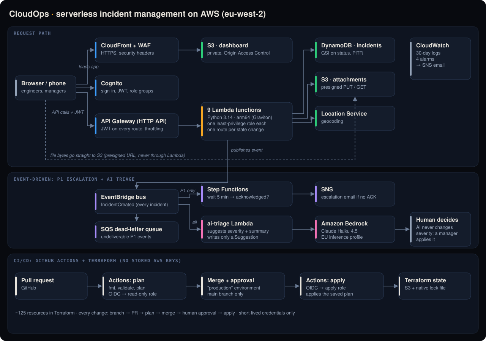

# CloudOps: Field Operations & Incident Management Platform

**Live demo:** https://d35plopv18aik3.cloudfront.net
*(Sign-in is by invitation: accounts are created by an administrator. See [Demo access](#demo-access).)*

A serverless platform for logging, working and closing IT / data-centre incidents, built hands-on on AWS, **defined entirely in Terraform** and **deployed only through a CI/CD pipeline with human approval**.



## Why this exists

While studying for the **AWS Certified Solutions Architect – Associate**, I missed getting my hands on something practical. I learn best by building. The labs showed me how each service works, but not *where* it belongs in a real system or *why* you would choose it. So I decided to pick a real problem and solve it end to end with AWS, learning each service by needing it.

The problem came from my own experience. In a previous role I saw the same thing again and again: when something went wrong, keeping everyone informed took nearly as much effort as fixing the issue. There was no official channel holding all the information. Updates were scattered across email, WhatsApp, text messages and phone calls, and the same update was explained repeatedly, to different people. Writing a report at the end meant collecting pieces from every channel, with no guarantee that everyone involved had seen the same information.

CloudOps solves that with one official place for every incident: its details, photos and full history of who did what and when. The moment an incident is logged, worked or resolved, everyone who needs to know can see the same information, a critical (P1) incident that nobody picks up escalates by itself, and an AI assistant suggests how urgent each new report really is. Along the way it taught me what the labs couldn't: real trade-offs, real permissions problems and real debugging.

## What it does

- **Incident lifecycle (ITIL style):** OPEN → IN PROGRESS → RESOLVED (engineer says it's fixed) → CLOSED (manager signs off), with Reopen and a full timeline of who did what and when.
- **Authentication and roles:** Amazon Cognito, JWT on every API route. Field engineers work incidents, managers sign off, view-only users can look and report. Every rule is enforced in the backend, never only in the UI.
- **Photo / file attachments** straight from a phone camera to S3 with presigned URLs. File bytes never pass through the API.
- **Automatic P1 escalation:** every new incident publishes an event. EventBridge picks out P1s and starts a Step Functions workflow that waits 5 minutes, checks whether anyone acknowledged it, and emails an escalation if not. No Lambda glue code.
- **AI triage (Amazon Bedrock):** every new incident is analysed asynchronously by Claude (Haiku 4.5, EU inference profile), which suggests a severity, a one-line summary and a reason. **The AI suggests, a human decides:** it can only write a suggestion field, and a manager applies it through the normal, role-checked API.
- **Monitoring:** CloudWatch alarms email on Lambda errors, API 5xx errors, undeliverable P1 events and failed escalations.

## How changes ship (CI/CD)

```
branch → pull request → terraform plan (read-only role) → review → merge
       → "production" environment: human approval → terraform apply (apply role)
```

- **No AWS keys in GitHub.** GitHub Actions authenticates with **OIDC**: each run gets short-lived credentials for one IAM role, and the trust policy only accepts tokens from this repository.
- **Two roles, least privilege:** pull requests can only *read* (plus the state lock); only the `production` environment, which is limited to `main` and requires an approval, can assume the apply role.
- **Apply runs exactly the reviewed plan** (`plan -out` then `apply tfplan`), one run at a time, with the account ID masked and the alert email passed as a secret (the logs of a public repo are public).
- Every change since the pipeline went live (UI skin, code cleanup, AI triage, model switch) went through this flow.

## Infrastructure as code

Everything is defined in [`terraform/`](terraform/), about **125 resources**, one file per concern:

| File | What it builds |
|---|---|
| `dynamodb.tf` | Incidents table, status index, PITR, deletion protection |
| `s3.tf` | Attachments + dashboard buckets (private, encrypted, HTTPS-only, lifecycle) |
| `cognito.tf` | User pool (admin-only sign-up), app client, role groups |
| `events.tf` | EventBridge bus + P1 rule, Step Functions workflow, SNS, DLQ |
| `lambda.tf` | 10 functions, each with its own IAM role and log group (code in `lambda_src/`) |
| `ai.tf` | AI triage: EventBridge rule → Lambda → Bedrock, model as a variable |
| `cloudfront.tf` | CloudFront, WAF, Origin Access Control, attachments CORS |
| `api.tf` | HTTP API, JWT authorizer, 10 routes, one invoke permission per route |
| `dashboard.tf` | Uploads the dashboard (`dashboard_src/`) with the live API / Cognito values filled in |
| `monitoring.tf` | Alarms and the ops-alerts topic |
| `ci.tf` | GitHub OIDC provider, plan role and apply role |

State is kept in S3 with native locking. The system was first built by hand in the console, then **inventoried with a read-only script, rebuilt as code alongside the original, tested end to end, and switched over**. The console version was deleted afterwards. Rebuilding as code exposed problems the console had hidden (a shared IAM role across five functions, open self sign-up, stale permissions), all fixed in the Terraform version.

## Key design decisions

| Decision | Why |
|---|---|
| **One API route per state change**, each with its own role check | Closed a real authorization hole (any user could close an incident through a generic update). Simple rules, easy to test. |
| **Resolved ≠ Closed** | The engineer says "fixed", the manager confirms. Matches how ITSM tools work. |
| **No hard delete** | Preserves the audit trail. |
| **EventBridge → Step Functions directly** | An earlier SQS + Lambda hop added cost, code and IAM surface for no benefit, so it was removed. |
| **Filter P1 in the EventBridge rule, not in code** | Every incident publishes one event; consumers decide what they care about (escalation = P1 only, AI triage = all). |
| **AI runs asynchronously and only suggests** | Creating an incident never waits for, or fails because of, the model. Output is validated (P1–P4 only, length-capped) and the prompt treats the report as data, not instructions (prompt-injection guard). |
| **Not an AI agent, on purpose** | One model call, no tools, no write access to severity. Predictable, cheap and safe for operations. |
| **Query a status index, not Scan** | Active / To verify / Closed tabs read only what they show. Trade-off noted: few status values means hot partitions at real scale. |
| **arm64 (Graviton) Lambdas** | About 20% cheaper per unit of compute. |
| **Presigned URLs for files** | The browser talks to S3 directly; Lambda never moves bytes. |

## Security highlights

- One IAM role per Lambda, listing only the calls its code makes; no `logs:CreateLogGroup`.
- Cognito sign-up is admin-only; roles come from Cognito groups inside the verified JWT.
- CloudFront with AWS WAF managed rules and security headers; both buckets private, HTTPS-only.
- CI/CD with OIDC and short-lived credentials, plan/apply role separation and a human approval gate.
- Secrets and personal data (alert email, account ID) never appear in the repository or the public CI logs.

## Real problems found and fixed

A few of the debugging stories behind the project (symptom → cause → fix):

1. **"Least privilege" that wasn't:** a read-only inventory showed five Lambdas sharing one role, so a read-only function could write to the database. The console's "use existing role" had quietly reused it. Terraform now gives every function its own role.
2. **The authorization hole:** a generic `PATCH` accepted `status: CLOSED` from any user, because "closed means locked" was never written down. Fixed with one route per state change, proven with a browser-console attack test.
3. **Every upload silently lost for weeks:** the attachments bucket had no CORS, and the record was saved before the upload, so failures left orphan records. Fixed the CORS and cleaned up with a script, which also rescued one "lost" photo.
4. **CI couldn't get into AWS** (`Not authorized to perform sts:AssumeRoleWithWebIdentity`): GitHub's OIDC token now carries immutable IDs (`repo:owner@id/name@id:…`). Instead of guessing, I read the exact claim in **CloudTrail** and updated the trust policy.
5. **Bedrock on a new account, five layers deep:** account verification → newest models not enabled → the Anthropic use-case form → Marketplace refusing a Direct Debit payment method → new-account quotas applied at 0 (a support case). Each step was diagnosed from the exact error message.

## Costs

At demo volume the whole platform costs **pennies a month**: serverless, pay-per-request everywhere, CloudFront on the free flat-rate plan, 30-day log retention and an S3 lifecycle on attachments. AI triage costs a fraction of a penny per incident. A monthly AWS budget alert guards against surprises.

## Tech stack

| Layer | Service |
|---|---|
| IaC / CI/CD | Terraform (AWS provider 6.x, S3 state), GitHub Actions with OIDC |
| Compute | AWS Lambda (Python 3.14, arm64 / Graviton) |
| API | Amazon API Gateway (HTTP API, JWT authorizer) |
| Database | Amazon DynamoDB |
| Auth | Amazon Cognito |
| Storage / CDN | Amazon S3, Amazon CloudFront, AWS WAF |
| Events | Amazon EventBridge, AWS Step Functions, Amazon SNS, Amazon SQS |
| AI | Amazon Bedrock (Anthropic Claude Haiku 4.5, Converse API) |
| Location | Amazon Location Service (geocoding) |
| Observability | Amazon CloudWatch (logs, alarms) |
| Frontend | Plain HTML / CSS / JavaScript (no framework, no build step) |

## Demo access

The live demo uses test accounts (a manager, a field engineer and a view-only user). Credentials are available on request, not published here because this is a live AWS account.

## Future work

- **An agent on top of triage:** search similar past incidents and runbooks to propose a fix, still with a human in the loop.
- **Start/stop escalation when severity changes** after creation (today only new P1s escalate).
- **Record "work started" in the timeline**, and confirm attachments on S3 upload events instead of before the upload.
- **Scale-out data model:** partition the status index by site or team to avoid hot partitions.

See [`docs/PROGRESS.md`](docs/PROGRESS.md) for the earlier build log (Sprints 1–7).

## Author

Paulo Martinho, [LinkedIn](https://www.linkedin.com/in/paulo-martinho-5957ab69/)
